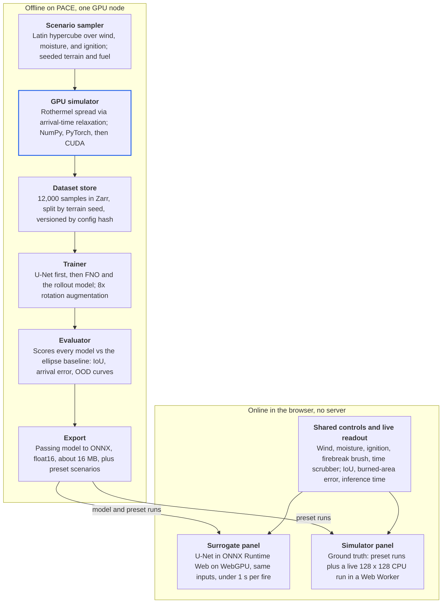
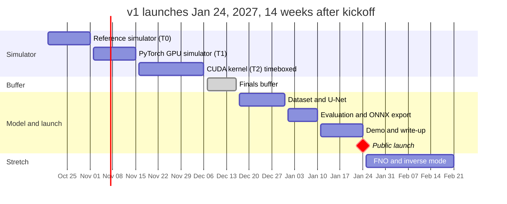

# Flamecast PRD: GPU Wildfire Simulator and Neural Surrogate

Dylan Houle · October 16, 2026

## Overview

Flamecast is a GPU wildfire simulator that runs 10,000 fire scenarios in one launch, plus a neural network trained on those runs that predicts a fire's full spread in under a second. It is the next version of [Flames](https://flames.dylanhoule.dev), rebuilt for throughput instead of a single interactive fire.

**The problem.** Physics fire models like Rothermel's are accurate enough to be useful but expensive to run: every cell, every step, every scenario. Answering questions like "where did this fire start?" or "where should a firebreak go?" means running the simulator thousands of times, and a step-by-step simulator cannot be differentiated to search those answers directly.

**The approach.** Three layers, each a project on its own:

1. **GPU simulator.** A grid-based Rothermel spread model written first in NumPy, then as batched PyTorch tensor ops, then as a custom CUDA kernel. Target: at least 40x faster than the best multicore CPU version.
2. **Dataset.** Procedurally generated terrain, fuel, moisture, wind, and ignition points, sampled to cover the parameter space evenly. Each run produces one time-of-arrival map.
3. **Neural surrogate.** A U-Net (then a Fourier Neural Operator, then an autoregressive world-model variant) that maps the input maps straight to the arrival-time map. Because it is differentiable, it can run backward to solve inverse and optimization problems.

**Why it matters.** The project covers the three skills in the career path: GPU systems, machine learning, and simulation used as training data. It is also a small, honest version of what NVIDIA, robotics labs, and world-model teams do at scale: build a simulator, generate data from it, and learn a fast model of it.

**Scope of v1:** simulator through the CUDA kernel, a 10,000-scenario dataset, a validated U-Net, and a public side-by-side demo. FNO, the autoregressive model, and inverse mode are stretch goals.

## Goals, non-goals, and success metrics

v1 succeeds when the simulator is 40x faster than multicore CPU, the surrogate reaches 0.85 burned-area IoU on held-out scenarios, and the demo shows both side by side.

### Goals

1. **G1: Batched GPU simulation.** Run 10,000 independent scenarios on a 256 x 256 grid in a single launch on one GPU.
2. **G2: Honest speedup.** Beat the best CPU baseline (vectorized NumPy across every core of one node) by at least 40x, measured end to end.
3. **G3: Fast surrogate.** Predict a full arrival-time map in under 10 ms on a data-center GPU and under 1 s in a laptop browser.
4. **G4: Accurate surrogate.** Burned-area IoU of at least 0.85 at the 2-hour mark on in-distribution test scenarios.
5. **G5: Know where it breaks.** Measure and publish accuracy outside the training range (wind, terrain, fuel), not just inside it.
6. **G6: Public and reproducible.** A live demo, an open repo, one-command scripts for every result, and a write-up with benchmarks.

### Non-goals

- **Operational fire prediction.** Flamecast is a research testbed. It will not be used for, or claimed to support, decisions on real incidents.
- **Full fire behavior.** No crown fire, spotting (embers jumping ahead), fire-atmosphere coupling, or suppression. Surface spread only.
- **Multi-GPU or multi-node scaling.** One GPU is the unit of work for v1.
- **Real-world data in v1.** Real fuel and elevation maps are a stretch goal, not a requirement.
- **Mobile performance parity.** The demo must run on a phone, but the speed targets are for a laptop.

### Success metrics

| Metric | v1 target | Stretch | How it is measured |
| --- | --- | --- | --- |
| Simulator throughput | 10,000 scenarios at 256 x 256 in 5 min | Under 1 min | Wall clock on one PACE A100 (40 GB) or H200, data on device |
| Speedup vs CPU | 40x | 100x | Same 10,000 scenarios on multicore NumPy, same node |
| Kernel efficiency | 60% of peak memory bandwidth | 80% | Nsight Compute on the spread kernel |
| GPU vs reference agreement | Max relative error 1e-4 | Bit-identical | 100 random scenarios, CUDA vs NumPy |
| Surrogate IoU at 2 h (in-distribution) | 0.85 | 0.92 | 1,000 held-out test scenarios |
| Arrival-time error | Mean absolute error under 10% of median arrival time | Under 5% | Burned cells only, test set |
| Surrogate latency | 10 ms GPU, 1 s browser | 200 ms browser | Batch of 1, 256 x 256 |
| Out-of-distribution report | Error curve published for 3 OOD axes | 5 axes | Wind, relief, fuel model, grid size, ignition count |
| Demo | Live at a public URL | Inverse mode live | Works on desktop Chrome and a phone |

## Users and use cases

The primary user is the builder; every other user sees the project through the demo or the repo, so those two surfaces carry the requirements.

| Persona | What they want | What they touch | Time they give it |
| --- | --- | --- | --- |
| Builder (me) | Learn CUDA, PyTorch, and ML evaluation on a real problem | Everything | 15 to 20 hrs/week |
| Recruiter at a booth or on a call | One concrete, checkable thing to remember | Demo on a phone | 60 seconds |
| Engineer reviewing a candidate | Proof the numbers are real and the trade-offs are understood | README, benchmark table, kernel code | 5 to 15 minutes |
| Simulation or ML researcher | Whether the evaluation is honest and where the model fails | Write-up, OOD results, repo | 30+ minutes |
| Curious visitor | Watch fire spread and play with wind | Demo | A few minutes |

### User stories

| ID | As a... | I want to... | So that... | Accepted when |
| --- | --- | --- | --- | --- |
| US-1 | builder | generate 10,000 scenarios with one command | I can iterate on the model without waiting on data | `make dataset` finishes on PACE and writes a versioned dataset |
| US-2 | builder | compare every simulator tier against the NumPy reference | I trust the fast versions | A test fails if any tier drifts past tolerance |
| US-3 | builder | profile the spread kernel | I know whether it is memory- or compute-bound | Nsight report and bandwidth number in the benchmark table |
| US-4 | recruiter | see the simulator and the model agree on a live fire | the project feels real in under a minute | Side-by-side view loads in under 3 s on a phone |
| US-5 | engineer | read one table of benchmarks with hardware and baselines named | I can judge the speedup claim | README has throughput, speedup, and baseline details |
| US-6 | researcher | see accuracy fall off outside the training range | I know the model's limits | OOD error curves published for wind, relief, and fuel |
| US-7 | visitor | drag a wind slider and draw a firebreak | I can see cause and effect | Both panels update in under 1 s |
| US-8 | visitor | draw a burn scar and ask where the fire started | I see what a differentiable model can do | Inverse mode returns an ignition estimate in under 5 s (stretch) |

## System architecture

Six stages run offline on one PACE GPU node; only the exported model and a few preset runs ship to the browser, so the demo needs no server.



The simulator is the one component everything else depends on: the dataset, the evaluator's ground truth, and the demo's left panel all come from it, which is why it is validated first.

## Simulator requirements

The simulator computes, for every cell, the time fire first arrives, using Rothermel spread rates on a regular grid, solved by parallel relaxation instead of timesteps.

### Model choices and why

- **Grid, not graph.** Flames spreads fire along a tree adjacency graph. On a GPU, a grid lets each thread read its neighbors from contiguous memory; a graph sends threads to scattered neighbor lists. Per-tree realism is traded for memory access the hardware is built for.
- **Arrival-time relaxation, not timesteps.** Each cell's arrival time is the minimum over its neighbors of (neighbor's arrival time + travel time from that neighbor). Repeating this update until nothing changes gives the same answer as a shortest-path search, with no timestep to tune. Each iteration is a pure stencil operation, the best possible fit for a GPU.
- **Jacobi (double-buffered) updates.** Every iteration reads from buffer A and writes to buffer B, then swaps. In-place updates converge in fewer iterations but depend on thread order, so results would differ run to run. Determinism wins for testing.
- **Precompute what does not change.** The no-wind, no-slope spread rate R0 depends only on fuel and moisture, so it is computed once per scenario. Only the directional wind and slope adjustment runs inside the loop.

### Domain and state

| Field | Type | Per cell | Notes |
| --- | --- | --- | --- |
| Grid size |  | 256 x 256 default | 128 and 512 for convergence and generalization tests |
| Cell size |  | 30 m | Matches the resolution of common US fuel and elevation datasets; domain = 7.68 km square |
| Elevation | float32 | 4 B | Slope and aspect derived by central differences |
| Slope x, slope y | float16 | 4 B | Stored as gradient components, not angle |
| Fuel model index | uint8 | 1 B | 3 to 5 standard fuel models in v1, plus non-burnable |
| Base spread rate R0 | float32 | 4 B | Precomputed per scenario |
| Arrival time (A and B) | float32 x 2 | 8 B | +infinity until reached; capped at 6 h |
| Scenario scalars | float32 |  | Wind speed, wind direction, dead fuel moisture |

About 21 bytes per cell plus overhead: roughly 1.4 MB per scenario, so 10,000 scenarios take about 14 GB. That fits on one of PACE's 40 GB A100s, 48 GB L40S cards, or H200s; the batch is split into chunks on anything smaller.

### Spread physics

- **Head-fire rate** from the Rothermel equation (Appendix), using the wind factor and slope factor as vectors summed to find the direction of maximum spread.
- **Directional rate** from an ellipse whose length-to-breadth ratio grows with wind speed (Anderson's relation, Appendix). A fire in calm, flat, uniform fuel spreads as a circle; wind stretches it downwind.
- **Neighbor stencil:** 8 neighbors in v1. An 8-neighbor grid makes fronts look octagonal, so a 16-neighbor stencil (adding knight's-move neighbors) is the P1 fix.
- **Units:** Rothermel is defined in imperial units (ft/min, BTU). The core math stays imperial internally and converts at the boundaries, which avoids a whole class of unit bugs.

### Implementation tiers

Each tier must match the one below it before the next one starts.

| Tier | What | Purpose | Exit criterion |
| --- | --- | --- | --- |
| T0 | NumPy reference, one scenario at a time | Ground truth; readable | Passes the physics tests in Validation |
| T1 | PyTorch tensor ops, batched \[B, H, W\] | First GPU version with no custom kernel | Matches T0 to 1e-4 relative on 100 random scenarios |
| T2 | Custom CUDA kernel via a PyTorch C++ extension | Learning CUDA; speed | Matches T0; at least 60% of peak memory bandwidth |
| T3 (stretch) | WebGPU compute shader | Run the real simulator in the demo | Matches T0 at 128 x 128 in Chrome |

### CUDA kernel design (T2)

- One thread per cell; the batch dimension maps to the grid's z dimension so one launch covers every scenario.
- Each thread block loads a 32 x 32 tile of arrival times plus a 1-cell halo (2 cells for the 16-neighbor stencil) into shared memory, then reads neighbors from there.
- A block-level reduction sets a "changed" flag; the host loop stops when no block changed anything, or at a maximum iteration count.
- The kernel is memory-bound (little math per byte), so the target is a fraction of peak memory bandwidth, not of peak FLOPs.

### Requirements

| ID | Requirement | Priority |
| --- | --- | --- |
| SIM-1 | Compute arrival time per cell for a batch of scenarios on a 256 x 256 grid | P0 |
| SIM-2 | Rothermel head-fire rate with wind and slope factors for at least 3 fuel models | P0 |
| SIM-3 | Elliptical directional spread from wind speed | P0 |
| SIM-4 | Deterministic: same inputs and seed give bit-identical output on the same GPU | P0 |
| SIM-5 | Non-burnable cells (water, rock, firebreaks) never ignite and block spread | P0 |
| SIM-6 | All tiers share one input format and one config file | P0 |
| SIM-7 | Batch of 10,000 completes in 5 min on one A100 or H200 | P0 |
| SIM-8 | 16-neighbor stencil option | P1 |
| SIM-9 | Multiple ignition points per scenario | P1 |
| SIM-10 | Spatially varying wind field | P2 |
| SIM-11 | WebGPU port for the browser | P2 |

## Dataset generation pipeline

One command samples 12,000 scenarios, runs them through the GPU simulator, and writes a versioned dataset of about 6 GB, split into train, validation, test, and out-of-distribution sets.

### Scenario parameters

| Parameter | In-distribution range | OOD range | Sampled how |
| --- | --- | --- | --- |
| Terrain | Fractal noise heightmap, 0 to 600 m relief | 600 to 1,200 m relief | Seeded procedural generator |
| Fuel map | 3 fuel models in noise-shaped patches, 0 to 10% non-burnable | A 4th fuel model never seen in training | Seeded procedural generator |
| Dead fuel moisture | 3% to 15% | 15% to 20% | Latin hypercube |
| Wind speed (midflame) | 0 to 15 m/s | 15 to 25 m/s | Latin hypercube |
| Wind direction | 0 to 360 degrees | Same | Latin hypercube |
| Ignition | 1 point in the central 50% of the domain | 2 to 3 points | Uniform over the region |

**Why Latin hypercube sampling:** pure random sampling leaves gaps and clusters by chance, so some wind and moisture combinations get hundreds of runs and others almost none. Latin hypercube splits each parameter's range into equal slices and uses every slice exactly once, so coverage is even with the same number of runs.

### Splits

| Split | Scenarios | Used for |
| --- | --- | --- |
| Train | 8,000 | Fitting the model |
| Validation | 1,000 | Early stopping and choosing hyperparameters |
| Test (in-distribution) | 1,000 | The headline accuracy numbers, touched once per model |
| OOD | 2,000 | 500 each: high wind, high relief, unseen fuel, multiple ignitions |

Splits are made by terrain seed, not by row, so no test terrain ever appears in training.

### Per-sample record

| Item | Shape | Type | Size |
| --- | --- | --- | --- |
| Elevation | 256 x 256 | float16 | 128 KB |
| Fuel model index | 256 x 256 | uint8 | 64 KB |
| Ignition mask | 256 x 256 | uint8 | 64 KB |
| Scalars (moisture, wind speed, wind direction) | 3 | float32 | 12 B |
| Arrival time (target) | 256 x 256 | float32, capped at 6 h | 256 KB |
| Metadata |  | JSON | Seeds, parameter values, simulator version, git commit |

About 512 KB per sample, about 6 GB for 12,000. A 100,000-sample version (about 50 GB) fits on PACE scratch storage if the model is data-limited.

### Storage and versioning

- **Format:** Zarr arrays chunked one scenario per chunk, so training reads random samples without loading the whole set.
- **Versioning:** every dataset folder is named by a hash of its config plus the simulator's git commit. Changing the physics produces a new dataset instead of silently overwriting the old one.
- **Reproducibility:** regenerating a dataset from its config must produce byte-identical arrays (this follows from SIM-4).

### Requirements

| ID | Requirement | Priority |
| --- | --- | --- |
| DATA-1 | One command generates all splits from a YAML config | P0 |
| DATA-2 | Latin hypercube sampling over continuous parameters | P0 |
| DATA-3 | Splits by terrain seed; no terrain shared across splits | P0 |
| DATA-4 | Metadata stored with every sample | P0 |
| DATA-5 | Full 12,000-sample generation in under 15 min including writes | P0 |
| DATA-6 | Dataset viewer script: renders any sample's inputs and arrival map | P1 |
| DATA-7 | Real-terrain set from public US elevation and fuel data for one area | P2 |

## Neural surrogate

The surrogate maps a stack of input maps to the arrival-time map in one forward pass; a U-Net is the v1 model, and every model must beat a no-learning baseline to count.

### Inputs and target

| Channel | Source | Encoding |
| --- | --- | --- |
| Elevation | Sample | Normalized per sample (subtract mean, divide by global std) |
| Slope x, slope y | Derived from elevation | Raw gradient components |
| Fuel model | Sample | One-hot, one channel per fuel model plus non-burnable |
| Dead fuel moisture | Scalar | Constant channel |
| Wind u, wind v | Scalar speed and direction | Two constant channels (east and north components) |
| Ignition mask | Sample | Binary channel |
| Distance from ignition | Derived | Euclidean distance transform, normalized |

About 12 channels in v1. The distance channel is a cheap hint: the network does not have to learn geometry from scratch.

**Target:** arrival time divided by the 6-hour cap, so values fall in \[0, 1\]; unburned cells are exactly 1. A second output head predicts a burned/unburned probability per cell.

### Models

| Model | What it is | Why | Priority |
| --- | --- | --- | --- |
| B0: Wind ellipse | No learning: an ellipse from the ignition point, stretched by wind, sized by mean spread rate | The floor. A model that cannot beat this has learned nothing. | P0 |
| M1: U-Net | Convolutional encoder-decoder, 4 downsampling levels, 32 base channels, about 8M parameters | Standard, fast, strong for image-to-image tasks | P0 |
| M2: Fourier Neural Operator | 4 spectral layers, 16 modes, width 64 | Learns in frequency space; can run at a different resolution than it was trained on | P1 |
| M3: Autoregressive world model | Predicts the burn state 10 minutes ahead from the current state; rolled out 36 times to reach 6 h | The world-model setup in miniature, including its central problem: errors compound each step | P2 |

### Loss

Total loss = mean squared error on normalized arrival time, over cells that burned + 1.0 x binary cross-entropy on the burned mask. The masked MSE keeps unburned cells from dominating; the cross-entropy keeps the fire's edge sharp instead of blurry.

For M3, train on multi-step rollouts (predict 4 steps, backpropagate through all of them) instead of single steps, so the model learns to correct its own drift.

### Training setup

| Setting | Value |
| --- | --- |
| Optimizer | AdamW, weight decay 1e-4 |
| Learning rate | 1e-3 peak, cosine decay, 500-step warmup |
| Batch size | 32 |
| Epochs | Up to 100, early stopping on validation IoU |
| Precision | bfloat16 mixed precision |
| Hardware | 1 GPU on PACE |
| Budget | Under 2 GPU-hours per U-Net run |
| Tracking | Every run logs config, git commit, dataset hash, and curves |

**Physics-consistent augmentation.** Rotating a scenario by 90 degrees must rotate the wind vector and slope vectors with it, or the augmented sample teaches wrong physics. With the vectors rotated correctly, 4 rotations x 2 flips give 8x the training data for free.

### Using the surrogate backward (stretch)

Because the surrogate is differentiable, gradients flow from its output back to its inputs.

- **Find the ignition.** Given an observed burn scar, place a soft ignition blob and move it by gradient descent until the predicted burn matches the scar.
- **Place a firebreak.** Given a budget of cells and a protected zone, learn a soft non-burnable mask that minimizes predicted burn inside the zone, then round it to real cells and check the answer with the real simulator.

Every backward-mode answer is re-checked with the simulator. The surrogate proposes, the physics confirms.

### Export

The trained U-Net is exported to ONNX and run in the browser with ONNX Runtime Web on WebGPU, falling back to WebAssembly. Weights are stored in float16 (about 16 MB) so the demo loads quickly.

### Requirements

| ID | Requirement | Priority |
| --- | --- | --- |
| ML-1 | B0 baseline implemented and scored on every test set | P0 |
| ML-2 | U-Net trains end to end from one config file | P0 |
| ML-3 | Physics-consistent rotation and flip augmentation, with a unit test | P0 |
| ML-4 | Every run reproducible from config, commit, and dataset hash | P0 |
| ML-5 | ONNX export that matches PyTorch outputs within 1e-3 | P0 |
| ML-6 | FNO trained and compared on the same test sets | P1 |
| ML-7 | Autoregressive model with multi-step rollout training | P2 |
| ML-8 | Inverse mode: ignition finding and firebreak placement | P2 |

## Validation and evaluation

Validation runs in two layers: the simulator is checked against physics, then the surrogate is checked against the simulator, and the surrogate is never trusted further than the simulator underneath it.

### Layer 1: Is the simulator right?

| Test | Setup | Pass condition |
| --- | --- | --- |
| Spread-rate check | Each fuel model across a grid of wind and moisture values | Head-fire rate within 5% of the published Rothermel reference values for that fuel model |
| Calm, flat, uniform | No wind, no slope, one fuel | Front is a circle: radius varies under 3% by direction (16-neighbor stencil) |
| Wind ellipse | Uniform wind, flat ground | Measured length-to-breadth ratio within 5% of Anderson's relation |
| Upslope | No wind, constant slope | Fire runs faster uphill by the factor the slope term predicts |
| Barrier | A non-burnable line across the domain | No cell beyond it ever ignites |
| Rotation symmetry | Rotate terrain, fuel, wind, and ignition by 90 degrees | Output is the rotated original, exactly |
| Grid convergence | Same scenario at 128, 256, 512 | Front position differences shrink as the grid gets finer |
| Tier agreement | 100 random scenarios through T0, T1, T2 | Max relative difference 1e-4 |

### Layer 2: Is the surrogate right?

**Metrics,** all computed against the simulator's output:

- **Burned-area IoU** at 1, 2, 4, and 6 hours: overlap of predicted and true burned regions divided by their union. The headline number.
- **Arrival-time mean absolute error** over cells that burned, in minutes and as a percentage of median arrival time.
- **Burned-area error:** predicted total area vs true, as a percentage. Catches models that get the shape right but the size wrong.
- **Front distance:** the largest distance in meters between the predicted and true fire edge (Hausdorff distance). Catches the one bad lobe that IoU averages away.
- **Latency:** time per prediction at batch size 1, on GPU and in the browser.

**Test sets and what each answers:**

| Test set | Question it answers |
| --- | --- |
| In-distribution test | Did the model learn the task at all? |
| High wind (15 to 25 m/s) | Does it extrapolate beyond the speeds it saw? |
| High relief (600 to 1,200 m) | Does it handle steeper terrain? |
| Unseen fuel model | Did it learn physics or memorize the three fuels? |
| Multiple ignitions | Can it merge fronts it never saw merge? |
| 512 x 512 grid (FNO only) | Does the operator really work at a new resolution? |

### Reporting rules

- Every model is scored against the B0 ellipse baseline on every test set, in one table.
- The in-distribution test set is evaluated once per final model. Model selection uses validation only.
- For each OOD axis, publish accuracy as a curve against the parameter (for example, IoU vs wind speed), not a single averaged number.
- Publish the 20 worst test cases with images of input, truth, prediction, and error. Failure cases go in the write-up, not just successes.

### Acceptance criteria for v1

- [ ] All Layer 1 tests pass in CI on T0 and on T1 or T2 on PACE
- [ ] U-Net beats B0 on every test set
- [ ] U-Net IoU at 2 h is at least 0.85 in-distribution
- [ ] OOD curves published for at least wind, relief, and fuel
- [ ] Worst-case gallery published

## Demo web app

The demo shows the simulator and the neural network side by side on the same fire, and lets the visitor push the model until it breaks.

### Layout

- **Left panel: Simulator.** Ground truth. In v1 this plays back precomputed runs plus a live CPU run at 128 x 128 in a Web Worker; with the WebGPU port (SIM-11) it runs live at 256 x 256.
- **Right panel: Neural prediction.** The U-Net running in the browser on the same inputs.
- **Difference overlay toggle.** Colors cells where the two disagree: predicted burned but not really, and the reverse, in two distinct colors.
- **Live readout.** IoU, burned-area error, and inference time for the current fire, updated on every change.
- **3D toggle.** Reuses the Flames three.js terrain view for the visual hook; the 2D top-down view is the default because it reads faster.

### Controls

| Control | Effect |
| --- | --- |
| Wind speed slider (0 to 25 m/s) | Re-runs both panels; the training range (0 to 15) is shaded on the slider |
| Wind direction dial | Re-runs both panels |
| Moisture slider | Re-runs both panels |
| Click on terrain | Sets the ignition point |
| Firebreak brush | Paints non-burnable cells |
| Time scrubber (0 to 6 h) | Shows the front at any moment, from the arrival-time map |
| New terrain button | Loads another procedural terrain seed |
| "Break it" preset | Jumps to 22 m/s wind so visitors watch accuracy fall in the readout |
| Find ignition (stretch) | Visitor draws a burn scar; the app animates the gradient search for where it started |

### Pages

1. **Demo.** The two panels and controls above.
2. **How it works.** A one-screen explanation with the architecture diagram, written for a recruiter, not a reviewer.
3. **Results.** The benchmark table, the accuracy table, the OOD curves, and the worst-case gallery.
4. **Links.** Repo, write-up, and the original Flames.

### Requirements

| ID | Requirement | Priority |
| --- | --- | --- |
| DEMO-1 | Side-by-side simulator and surrogate on identical inputs | P0 |
| DEMO-2 | Surrogate inference in browser under 1 s on a recent laptop | P0 |
| DEMO-3 | First load under 3 s on a phone on LTE (weights lazy-loaded after first paint) | P0 |
| DEMO-4 | Live IoU and timing readout | P0 |
| DEMO-5 | Wind, moisture, ignition, firebreak, and time controls | P0 |
| DEMO-6 | Training range marked on the wind slider plus the "Break it" preset | P0 |
| DEMO-7 | Results page with every published number | P0 |
| DEMO-8 | Usable on a phone screen: panels stack vertically | P0 |
| DEMO-9 | 3D terrain toggle | P1 |
| DEMO-10 | Find-ignition inverse mode | P2 |

**Hosting:** a subdomain of dylanhoule.dev, served as static files; no backend is needed for v1, so it costs nothing to keep online.

## Performance targets and compute budget

The whole project needs about 100 GPU-hours on PACE, and the spread kernel is limited by memory bandwidth, so its target is set in bytes per second, not FLOPs.

### Back-of-envelope: why 5 minutes is conservative

- **Bytes per iteration.** Across 10,000 scenarios, one relaxation iteration reads arrival times, R0, slope, and fuel (about 8.5 GB) and writes new arrival times (about 2.6 GB): roughly 11 GB.
- **Time per iteration.** A PACE A100 has about 1.5 TB/s of memory bandwidth. At the 60% efficiency target, one iteration takes about 12 ms.
- **Iterations to converge.** Relaxation needs about as many iterations as the longest fire path measured in cells: a few hundred on a 256 x 256 grid, more when fuel breaks force detours. Budget 500.
- **Total.** 500 x 12 ms = about 6 seconds of kernel time. The 5-minute target leaves room for data movement, convergence checks, and a first version that is far from optimal.

This estimate is the roofline habit in miniature: work out the hardware limit before profiling, then measure how close the real kernel gets.

### Performance targets

| Stage | v1 target | Stretch | Measured with |
| --- | --- | --- | --- |
| Simulate 10,000 scenarios (T2) | 5 min | 1 min | Wall clock, CUDA events |
| Spread kernel bandwidth | 60% of peak | 80% | Nsight Compute |
| Speedup vs multicore NumPy | 40x | 100x | Same scenarios, same node |
| Generate and write full dataset | 15 min | 5 min | Wall clock |
| Train one U-Net | 2 GPU-hours | 1 | Training logs |
| Surrogate inference, GPU | 10 ms | 2 ms | Batch of 1, after warmup |
| Surrogate inference, browser | 1 s | 200 ms | Recent laptop, Chrome, WebGPU |
| Demo first paint, phone | 3 s | 1.5 s | Lighthouse on simulated LTE |

**Benchmark rule:** the CPU baseline is the best CPU version, vectorized and using every core, not a single-threaded loop. A speedup against a weak baseline is the first thing a reviewing engineer checks and the fastest way to lose credibility.

### Compute budget

| Activity | Runs | GPU-hours each | Total GPU-hours |
| --- | --- | --- | --- |
| Simulator development and benchmarking |  |  | 15 |
| Dataset generation, including regenerations | 10 | 0.25 | 2.5 |
| U-Net training and tuning | 20 | 2 | 40 |
| FNO training (P1) | 10 | 2 | 20 |
| Autoregressive model (P2) | 5 | 4 | 20 |
| Evaluation and OOD sweeps |  |  | 5 |

About 100 GPU-hours total; about 60 for P0 work alone.

### Hardware

- **PACE Phoenix** has A100 nodes with 40 GB per GPU ([PACE](https://pace.gatech.edu/2023/03/07/new-compute-nodes-on-the-phoenix-cluster)) and has added H200 and L40S nodes ([PACE](https://pace.gatech.edu/?p=9234)). Any of these fits the full 10,000-scenario batch.
- **Access:** Phoenix's free tier is offered to faculty for their research ([PACE](https://pace.gatech.edu/phoenix-cluster)), so student access goes through a sponsor or the Supercomputing Club. Confirm this before November (Open questions).
- **Local development:** a Mac has no CUDA. T0 and T1 run locally on small grids (PyTorch's Apple GPU backend), and all T2 kernel work happens on PACE over SSH.
- **Fallback:** a cloud notebook GPU for T1 and training if PACE queues are long.

## Tech stack and repo structure

Python and PyTorch for everything offline, one CUDA kernel as a PyTorch extension, and the existing Flames TypeScript and three.js front end for the demo.

| Layer | Choice | Why this over the alternative |
| --- | --- | --- |
| Language | Python 3.12 | One language for simulator tiers, data, training, and evaluation |
| Reference simulator | NumPy | Readable ground truth; the obvious CPU baseline |
| GPU simulator | PyTorch tensor ops (T1), CUDA C++ via a PyTorch C++ extension (T2) | The kernel is tested from Python against T0 with the same harness; no separate build system |
| Profiling | Nsight Systems (timeline), Nsight Compute (kernel bandwidth) | The standard NVIDIA tools; their reports go straight into the write-up |
| Data | Zarr | Chunked random access for training; works on cluster storage |
| Config | YAML files, one per experiment | Every result traces back to a file in the repo |
| Training | PyTorch, bfloat16 mixed precision | Same framework as T1; bf16 roughly halves memory with little accuracy cost |
| Experiment tracking | TensorBoard (local) or Weights and Biases | Curves and configs per run |
| Testing | pytest; GPU tests marked and run on PACE | CPU tests run on every push; GPU tests run before every merge to main |
| Cluster jobs | Slurm batch scripts | PACE schedules jobs through Slurm |
| Export | ONNX | One file the browser runtime can load |
| Browser inference | ONNX Runtime Web (WebGPU, WebAssembly fallback) | Runs the model client-side, so no server |
| Front end | TypeScript, three.js, Vite | Reuses Flames code and skills |
| Hosting | Static files on a dylanhoule.dev subdomain | Free to keep online |

### Repository layout

```
flamecast/
  sim/
    reference.py        # T0 NumPy simulator
    torch_sim.py        # T1 batched PyTorch simulator
    cuda/
      spread_kernel.cu  # T2 CUDA kernel
      binding.cpp       # PyTorch extension glue
    rothermel.py        # spread-rate math, imperial units inside
    fuels.py            # fuel model parameter tables
  data/
    terrain.py          # procedural heightmaps and fuel maps
    sampler.py          # Latin hypercube scenario sampler
    generate.py         # runs the simulator, writes Zarr
  model/
    baseline_ellipse.py # B0
    unet.py             # M1
    fno.py              # M2
    autoregressive.py   # M3
    train.py
    export_onnx.py
  eval/
    metrics.py          # IoU, arrival MAE, area error, Hausdorff
    run_eval.py         # all test sets, all models, one table
    gallery.py          # worst-case images
  inverse/
    find_ignition.py
    place_firebreak.py
  configs/              # one YAML per experiment
  slurm/                # PACE job scripts
  tests/
    test_physics.py     # Layer 1 validation
    test_tiers.py       # T0 vs T1 vs T2 agreement
    test_augment.py     # rotation consistency
  web/                  # demo front end
  docs/                 # write-up and figures
  Makefile              # make dataset, make train, make eval, make bench
```

## Milestones and timeline

v1 launches 14 weeks after an Oct 19 kickoff, with finals week and winter break built into the plan instead of left to chance.



Midterms on Nov 11 and Nov 16 fall at the T1 to T2 handoff, so the first CUDA week is planned light. Winter break carries the dataset and U-Net phase, when weekly hours can run higher.

### Exit criteria for each phase

A phase is done only when its gate passes; the next phase does not start on a partial pass.

1. **Reference simulator (T0):** every Layer 1 physics test passes.
2. **PyTorch GPU simulator (T1):** matches T0 to 1e-4 on 100 random scenarios; first benchmark against multicore NumPy recorded.
3. **CUDA kernel (T2):** matches T0 and reaches 60% of peak memory bandwidth, or the 3-week timebox ends and v1 continues on T1.
4. **Dataset and U-Net:** all splits generated and versioned; U-Net beats B0 and reaches 0.85 IoU at 2 h on validation.
5. **Evaluation and ONNX export:** test and OOD results final; ONNX outputs match PyTorch within 1e-3.
6. **Demo and write-up:** demo live on a phone and a laptop, repo public, write-up posted, every v1 acceptance box in Validation ticked.
7. **Stretch:** starts only after launch; FNO first, then inverse mode.

## Risks and mitigations

The biggest risk is the CUDA learning curve stalling everything behind it, so the plan makes the PyTorch tier shippable on its own and timeboxes the kernel.

| Risk | Early warning sign | Mitigation | Fallback if it happens anyway |
| --- | --- | --- | --- |
| CUDA learning curve stalls the project | T2 not matching T0 after 2 weeks | Timebox T2 to 3 weeks; dataset and training run on T1, which does not wait for T2 | Ship v1 on T1; the CUDA kernel becomes v1.1 |
| PACE access or long queues | No allocation confirmed by Nov 1; jobs waiting hours | Ask about access in October; develop at 64 x 64 locally; submit short jobs | Cloud notebook GPU for T1 and training |
| Surrogate misses 0.85 IoU | Validation IoU flat under 0.75 after tuning | Add the distance channel, more data (the simulator is cheap), larger model, fewer fuel models | Report the honest number with the error analysis; the project still stands |
| Grid makes fronts octagonal | Calm-flat test shows over 5% radius variation by direction | 16-neighbor stencil (SIM-8) | Document the bias and its size |
| Rothermel implementation bug | Spread-rate check off by more than 5% | Test each term separately against reference values before combining | Restrict v1 to the fuel models that pass |
| Model learns the procedural generator, not physics | Unseen-fuel and high-relief OOD scores collapse | Report OOD curves; vary generator settings more widely | State the limit plainly in the write-up |
| Browser inference too slow | Over 1 s on a laptop | float16 weights; run at 128 x 128 and upsample | Precompute surrogate outputs for preset scenarios |
| Scope creep into P1 and P2 | FNO or inverse work starts before P0 acceptance criteria pass | P0 checklist must be green before any P1 work | Cut P2 entirely from v1 |
| Coursework spikes around exams | Weekly hours drop under 10 for 2 weeks | Buffer weeks built into the timeline; winter break absorbs slip | Move the launch date, not the quality bar |

## Open questions and decisions log

Six design decisions are settled below; the open questions that block work are PACE access and how the demo runs the real simulator.

### Open questions

- [ ] How do I get PACE GPU time as a student: through the Supercomputing Club, a faculty sponsor, or the instructional cluster? How many GPU-hours, and on which GPUs?
- [ ] Demo simulator: precomputed runs plus a 128 x 128 CPU run, or build the WebGPU port (SIM-11) for v1?
- [ ] Which 3 fuel models for v1? Grass, shrub, and timber litter give the widest spread-rate contrast.
- [ ] Is there a faculty member in fire science, computational science, or ML who would review the evaluation?
- [ ] Real-terrain stretch: which area and which public elevation and fuel datasets?
- [ ] Name: keep "Flamecast," or ship as Flames v2 under the existing brand?
- [ ] License: MIT for code, and what for the dataset?
- [ ] Write-up format: blog post on dylanhoule.dev, or a short arXiv-style paper?

### Decisions

| Decision | Chosen | Over | Reason |
| --- | --- | --- | --- |
| Domain representation | Regular grid | Tree graph (Flames v1) | Contiguous memory access for GPU threads |
| Spread solver | Arrival-time relaxation | Timestep cellular automaton | No timestep to tune; each iteration is a pure stencil |
| Update scheme | Jacobi, double-buffered | In-place updates | Deterministic output; easier testing |
| CUDA integration | PyTorch C++ extension | Standalone CUDA program | Same test harness as T0 and T1; tensors passed directly |
| First model | U-Net | FNO | Simpler, well understood, strong baseline; FNO follows as a comparison |
| CPU baseline | Vectorized multicore NumPy | Single-threaded loop | Honest speedup claims |

## Appendix: math reference and glossary

These are the equations the simulator implements, in the forms given in the Forest Service's reference explanation of the Rothermel model ([Andrews 2018](https://d10.nrfirescience.org/sites/default/files/2023-07/rmrs_gtr371.pdf)).

### Head-fire rate of spread (Rothermel)

$$
R = \frac{I_R \, \xi \, (1 + \phi_w + \phi_s)}{\rho_b \, \varepsilon \, Q_{ig}}
$$

The numerator is heat delivered forward: reaction intensity I\_R times the share that reaches unburned fuel, ξ, boosted by the wind and slope factors. The denominator is heat needed to ignite: fuel bed bulk density ρ\_b times the fraction heated to ignition, ε, times heat of preignition Q\_ig. With no wind and no slope this is R0, computed once per scenario.

### Wind and slope factors

$$
\phi_w = C \, U^{B} \left( \frac{\beta}{\beta_{op}} \right)^{-E}
$$

$$
\phi_s = 5.275 \, \beta^{-0.3} \, (\tan \phi)^2
$$

U is midflame wind speed in ft/min. C, B, and E depend on the fuel's surface-area-to-volume ratio; β is the packing ratio and β\_op its optimum; φ is the slope angle. The simulator treats wind and slope as vectors and sums them to get the direction of maximum spread.

### Spread shape (elliptical)

Length-to-breadth ratio from midflame wind speed U in mi/h, Anderson's relation as used by FARSITE and FlamMap with its 0.397 adjustment ([FARSITE docs](https://owfflammaphelp62.firenet.gov/LegacyFARSITE/Tech_Elliptical_Dimensions.htm)):

$$
LB = 0.936 \, e^{0.2566 \, U} + 0.461 \, e^{-0.1548 \, U} - 0.397
$$

Eccentricity, then spread rate at angle θ from the head-fire direction, with ignition at the ellipse's rear focus:

$$
e = \frac{\sqrt{LB^2 - 1}}{LB}, \qquad R(\theta) = R_{head} \, \frac{1 - e}{1 - e \cos \theta}
$$

At θ = 0 this gives the head rate; at θ = 180 degrees it gives the slow backing rate. With no wind, LB = 1, e = 0, and spread is a circle.

### Arrival-time relaxation

$$
T_i^{(k+1)} = \min\left( T_i^{(k)}, \; \min_{j \in N(i)} \left[ T_j^{(k)} + \frac{d_{ij}}{R_{j \to i}} \right] \right)
$$

Cell i's arrival time is the earliest time fire can reach it from any neighbor j: the neighbor's arrival time plus distance d\_ij divided by the directional spread rate from j toward i. Ignition cells start at 0, all others at infinity. Iterate until no cell changes.

### Glossary

| Term | Meaning |
| --- | --- |
| Arrival time | When fire first reaches a cell; the simulator's output and the surrogate's target |
| Rate of spread (ROS) | How fast the fire front moves, here in ft/min internally |
| Head, flank, backing fire | The fastest-moving front (downwind/upslope), the sides, and the slow rear |
| Fuel model | A standard set of fuel-bed parameters (load, depth, particle size) for a vegetation type |
| Surrogate (emulator) | A fast learned model that imitates a slower simulator |
| U-Net | A convolutional network that shrinks the image to capture context, then expands it back, with skip connections for detail |
| Fourier Neural Operator (FNO) | A network that learns in frequency space, so it can run at resolutions it was not trained on |
| Autoregressive rollout | Predicting the next state, feeding it back in, and repeating; errors compound |
| IoU | Intersection over union: overlap of two regions divided by their combined area; 1.0 is a perfect match |
| Hausdorff distance | The largest gap between two boundaries; catches a single bad lobe |
| Stencil | An update where each cell reads a fixed pattern of neighbors |
| Halo | The extra border of cells a thread block loads so edge threads can read their neighbors |
| Jacobi iteration | Read all old values, write all new values to a separate buffer, then swap |
| Memory-bound | Limited by how fast data moves, not how fast math runs |
| Roofline | Comparing a kernel's speed to the hardware's bandwidth and compute limits |
| OOD | Out of distribution: inputs outside the range seen in training |
| Latin hypercube sampling | Sampling that uses every slice of each parameter's range exactly once |

### Sources

- [Andrews 2018, The Rothermel surface fire spread model and associated developments (RMRS-GTR-371)](https://d10.nrfirescience.org/sites/default/files/2023-07/rmrs_gtr371.pdf)
- [Rothermel 1972, A mathematical model for predicting fire spread in wildland fuels (INT-115)](https://www.fs.usda.gov/rm/pubs_int/int_rp115.pdf)
- [Anderson 1983, Predicting wind-driven wild land fire size and shape](https://biodiversitylibrary.org/item/137374)
- [FARSITE technical documentation: elliptical dimensions](https://owfflammaphelp62.firenet.gov/LegacyFARSITE/Tech_Elliptical_Dimensions.htm)
- [PACE: A100 nodes on Phoenix](https://pace.gatech.edu/2023/03/07/new-compute-nodes-on-the-phoenix-cluster)
- [PACE: H200 and L40S nodes on Phoenix](https://pace.gatech.edu/?p=9234)
- [PACE: Phoenix cluster](https://pace.gatech.edu/phoenix-cluster)